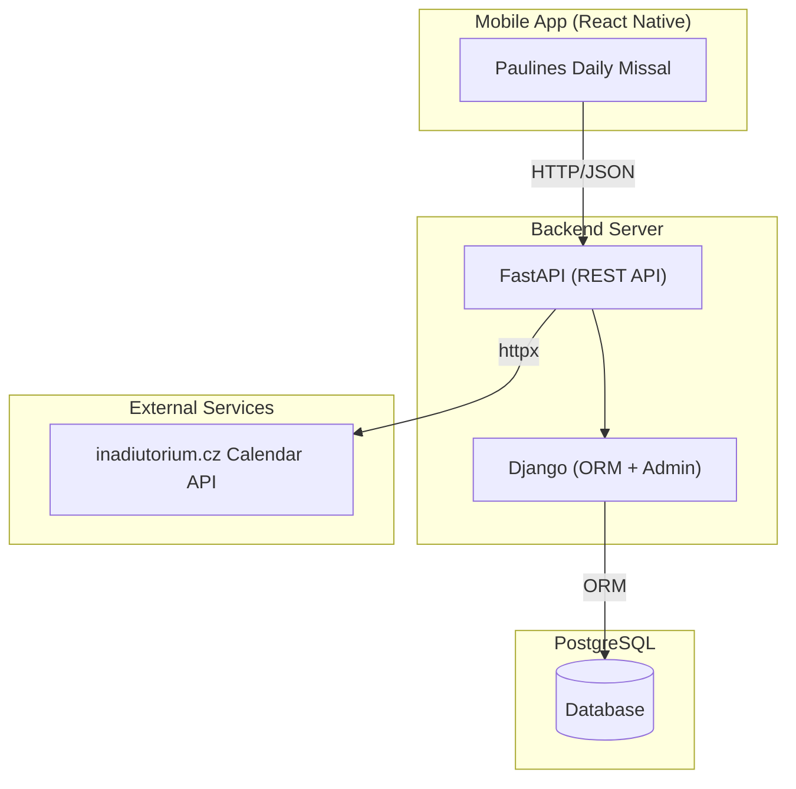
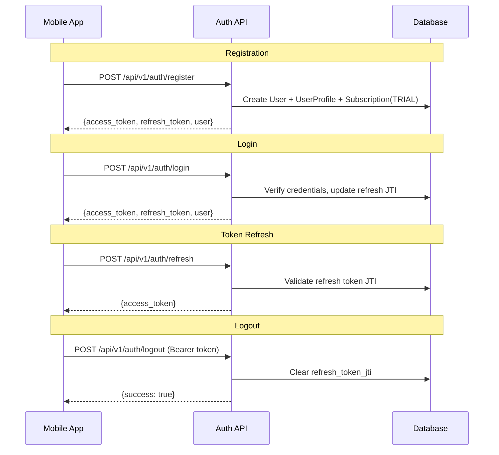
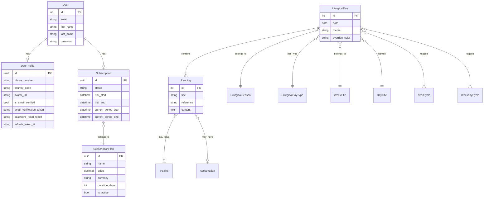
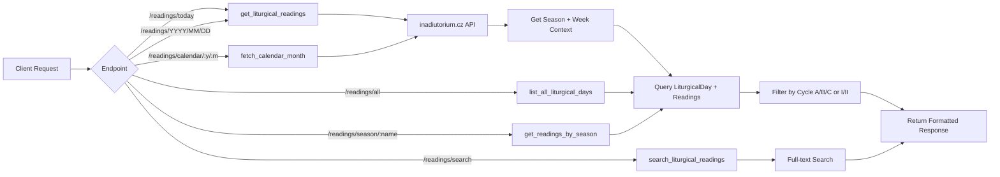

# Paulines Daily Missal - Backend API

A hybrid **FastAPI + Django** backend that serves Catholic liturgical readings, manages user authentication, subscriptions, and an admin dashboard.

## Tech Stack

- **FastAPI** - async REST API layer
- **Django 4.2** - ORM, admin interface, migrations
- **PostgreSQL** - primary database
- **JWT (PyJWT)** - access + refresh token authentication
- **bcrypt** - password hashing
- **Jazzmin** - modern Django admin theme
- **httpx** - async HTTP client for external API calls

## Architecture Overview



## Authentication Flow



## Data Model



## Readings Data Flow



## API Endpoints

### Authentication (`/api/v1/auth`)

| Method | Endpoint | Auth | Description |
|--------|----------|------|-------------|
| POST | `/register` | No | Create account (returns tokens + user) |
| POST | `/login` | No | Login (returns tokens + user) |
| POST | `/refresh` | No | Refresh access token |
| POST | `/logout` | Yes | Invalidate refresh token |
| POST | `/verify-email` | No | Verify email with token |
| POST | `/resend-verification` | No | Resend verification email |
| POST | `/forgot-password` | No | Send password reset token |
| POST | `/reset-password` | No | Reset password with token |

### Profile (`/api/v1/auth/profile`)

| Method | Endpoint | Auth | Description |
|--------|----------|------|-------------|
| GET | `/profile` | Yes | Get current user profile |
| PUT | `/profile` | Yes | Update profile (name, phone, avatar) |
| PUT | `/change-password` | Yes | Change password |
| DELETE | `/profile` | Yes | Delete account |

### Subscriptions (`/api/v1/subscriptions`)

| Method | Endpoint | Auth | Description |
|--------|----------|------|-------------|
| GET | `/plans` | No | List available subscription plans |
| GET | `/status` | Yes | Get current subscription status |
| POST | `/activate-trial` | Yes | Activate 7-day free trial |

### Readings (`/api/v1/readings`)

| Method | Endpoint | Auth | Description |
|--------|----------|------|-------------|
| GET | `/today` | No | Today's liturgical readings |
| GET | `/{year}/{month}/{day}` | No | Readings for specific date |
| GET | `/all` | No | Paginated list of all liturgical days |
| GET | `/search?q=keyword` | No | Search readings by keyword |
| GET | `/season/{season_name}` | No | Readings filtered by liturgical season |
| GET | `/calendar/{year}/{month}` | No | Catholic calendar data (proxied) |

## Response Format

All endpoints return a standardized response:

```json
{
  "success": true,
  "message": "Success",
  "data": {},
  "meta": {
    "total_items": 5,
    "total_pages": 1,
    "page": 1,
    "page_size": 10
  },
  "timestamp": "2026-02-01T12:34:56Z"
}
```

## Project Structure

```
daily-missal-app-dashboard/
├── accounts/               # User management Django app
│   ├── models.py           #   UserProfile, SubscriptionPlan, Subscription
│   ├── admin.py            #   Django admin registrations
│   └── migrations/
├── fastapi_api/            # FastAPI REST API
│   ├── main.py             #   App entry point, CORS, middleware
│   ├── api/v1/
│   │   ├── router.py       #   Central router
│   │   ├── auth/           #   Auth + profile endpoints
│   │   ├── readings/       #   Readings endpoints
│   │   └── subscriptions/  #   Subscription endpoints
│   ├── core/
│   │   ├── security.py     #   JWT + password hashing
│   │   ├── deps.py         #   FastAPI dependencies
│   │   ├── exceptions.py   #   Error handling
│   │   └── standard_response.py
│   ├── services/           #   Business logic
│   └── schemas/            #   Pydantic models
├── missal/                 # Liturgical data Django app
│   ├── models/             #   LiturgicalDay, Reading, Season, etc.
│   ├── admin.py            #   Admin with Jazzmin theme
│   └── services/           #   ORM query services
├── paulines/               # Django project config
│   ├── settings.py         #   DB, apps, JWT config
│   ├── urls.py             #   Admin + media URLs
│   └── asgi.py
├── manage.py
└── requirements.txt
```

## Setup

### Prerequisites

- Python 3.12+
- PostgreSQL
- Virtual environment

### Installation

```bash
# Clone and enter directory
cd daily-missal-app-dashboard

# Create virtual environment
python -m venv .venv
source .venv/bin/activate

# Install dependencies
pip install -r requirements.txt

# Configure environment variables
cp .env.example .env
# Edit .env with your database credentials

# Run migrations
python manage.py migrate

# Create superuser (for admin access)
python manage.py createsuperuser

# Start the server
uvicorn fastapi_api.main:app --reload --port 8000
```

### Environment Variables

| Variable | Description | Default |
|----------|-------------|---------|
| `DJANGO_SECRET_KEY` | Django secret key | Required |
| `JWT_SECRET_KEY` | JWT signing key | Falls back to DJANGO_SECRET_KEY |
| `DATABASE_NAME` | PostgreSQL database name | Required |
| `DATABASE_USER` | PostgreSQL username | Required |
| `DATABASE_PASSWORD` | PostgreSQL password | Required |
| `DATABASE_HOST` | PostgreSQL host | `localhost` |
| `DATABASE_PORT` | PostgreSQL port | `5432` |

### Access Points

| URL | Description |
|-----|-------------|
| `http://localhost:8000/api/docs` | Swagger UI (API docs) |
| `http://localhost:8000/api/redoc` | ReDoc (API docs) |
| `http://localhost:8000/admin` | Django Admin Dashboard |

## Token Details

- **Access Token**: 30-minute expiry, HS256 algorithm
- **Refresh Token**: 30-day expiry, includes JTI for revocation
- **Password Hashing**: bcrypt via passlib
- Refresh tokens are tracked by JTI in UserProfile, enabling server-side revocation on logout
